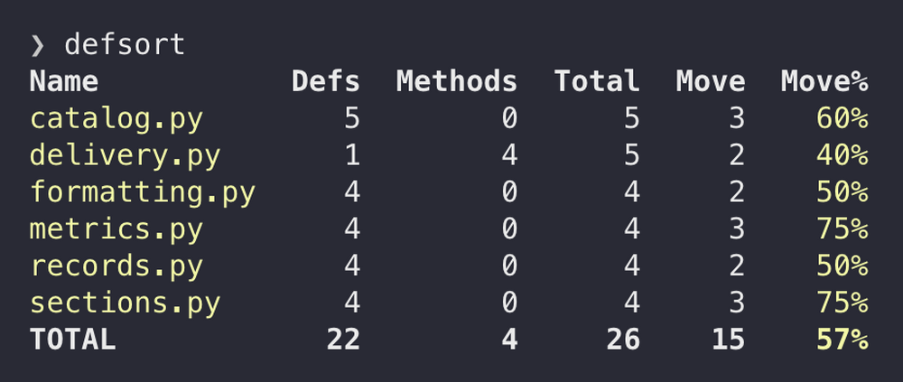
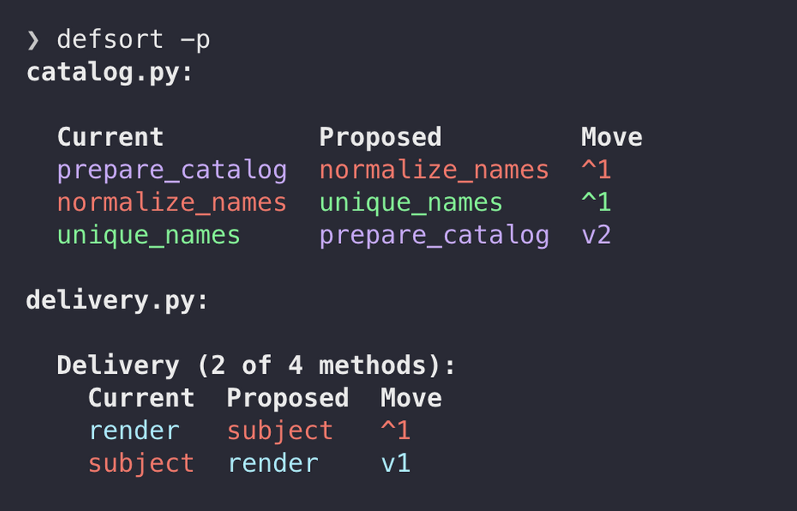

# defsort

defsort applies a configurable ordering policy to Python functions, classes, and methods. It makes
definition order deterministic, so placement follows a project convention rather than accumulating
from successive edits.

Run `defsort` to see how much would change across your project:



Then use `defsort --preview` to see where definitions move. Colors track definitions between the
Current and Proposed columns. For example:



Use the CLI to preview and apply changes, an agent hook to sort before commits, or the Python
library to integrate sorting into your own tools.

## Installation

defsort requires CPython 3.13 or later. Install the current checkout from the repository root with
[uv](https://docs.astral.sh/uv/):

```bash
uv tool install .
```

To update an existing installation after pulling changes:

```bash
uv tool install --reinstall .
```

Git 2.42 or newer is required for agent hooks, incremental mode, and a configured reorder guard.
Ordinary CLI sorting and the library do not require Git. See
[platform compatibility](docs/platform.md) for runtime requirements and file-handling details.

## Quick start

Start with a summary, preview movement, inspect the diff, then apply the changes:

```bash
defsort
defsort --preview
defsort --diff
defsort --write
```

The first three commands leave files unchanged. They exit 1 when changes or skipped files need
attention; exit 2 indicates an error. A successful write exits 0 unless files were skipped.

Choose dependency or alphabetical ordering, with separate policies for top-level definitions and
class methods. Automatic sorting trades control over individual placement for consistency.
Dependency changes can produce large reorders; alphabetical order can separate related code. Use
comment banners to preserve sections. See
[ordering policies](docs/design.md#choose-an-ordering-policy) for the choices and tradeoffs.

The defaults use dependency ordering, alphabetical ties, and lifecycle methods first. No
configuration is required. To keep class methods in their authored order while sorting top-level
definitions, add:

```toml
[tool.defsort]
method-order = "none"
```

defsort checks for changes that could break definition-time references and preserves decorators,
comments, and source layout. Its checks are bounded: classes whose behavior depends on method order
should use `method-order = "none"`. Read the [safety model](docs/design.md#safety-model) before
adopting it in order-sensitive code.

For an existing codebase, the [incremental guide](docs/incremental.md) explains how to establish
sorted baselines file by file and limit later reordering.

## Integrations

- **Coding agents:** the recommended PreToolUse hook sorts staged Python content before supported
  commits and preserves partial staging. Follow the [hook setup guide](docs/hook.md#configuration)
  for Claude Code, Codex, or Antigravity. Choose either plugin installation or manual registration.
- **Multiple formatting hooks:** use the
  [composition guide](docs/hook.md#composing-with-other-hooks) to run modifying hooks in order. It
  includes the current Antigravity limitation.
- **pre-commit:** use a local registration with an installed CLI as described in the
  [pre-commit guide](docs/hook.md#pre-commit).

## Library API

```python
import defsort

source = 'def zebra(): pass\n\ndef alpha(): pass\n'
result = defsort.check(source)
if result.status == 'changed':
    source = defsort.sort(source)
```

Use `check()` to inspect skipped or invalid source before deciding what to do. The
[library reference](docs/library.md) describes configuration, results, and the public adapter API.

## Documentation

| If you want to...                                   | Read                                       |
| --------------------------------------------------- | ------------------------------------------ |
| Choose an ordering policy and understand its limits | [Concepts and safety](docs/design.md)      |
| Preview, apply, or automate a sort                  | [CLI reference](docs/cli.md)               |
| Configure agent hooks or pre-commit                 | [Hook guide](docs/hook.md)                 |
| Control reordering during adoption                  | [Incremental mode](docs/incremental.md)    |
| Call defsort from Python                            | [Library reference](docs/library.md)       |
| Check runtime, encoding, or path behavior           | [Platform compatibility](docs/platform.md) |

## Development

See the [development guide](docs/development.md) for pinned CI dependencies and lock updates.

Run `make setup` with uv 0.12.23 to create the pinned `.venv` before project commands.
`make install` and `make reinstall` install only the CLI through uv.

```bash
make quality # read-only quality checks
make check   # quality checks and one full test run
make format  # apply repository formatters
```

To contribute an agent integration, see
[adding a bundled agent](docs/hook.md#adding-a-bundled-agent).

## License

defsort is distributed under the [MIT License](LICENSE).
